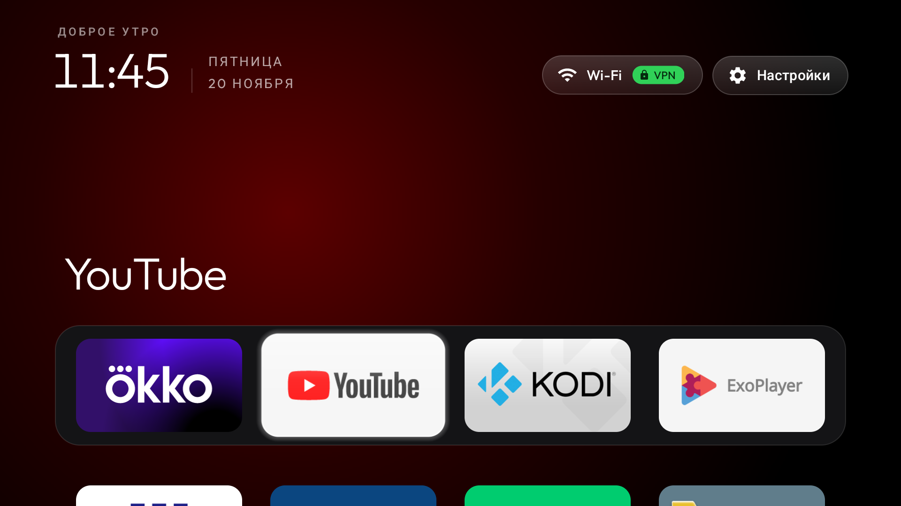
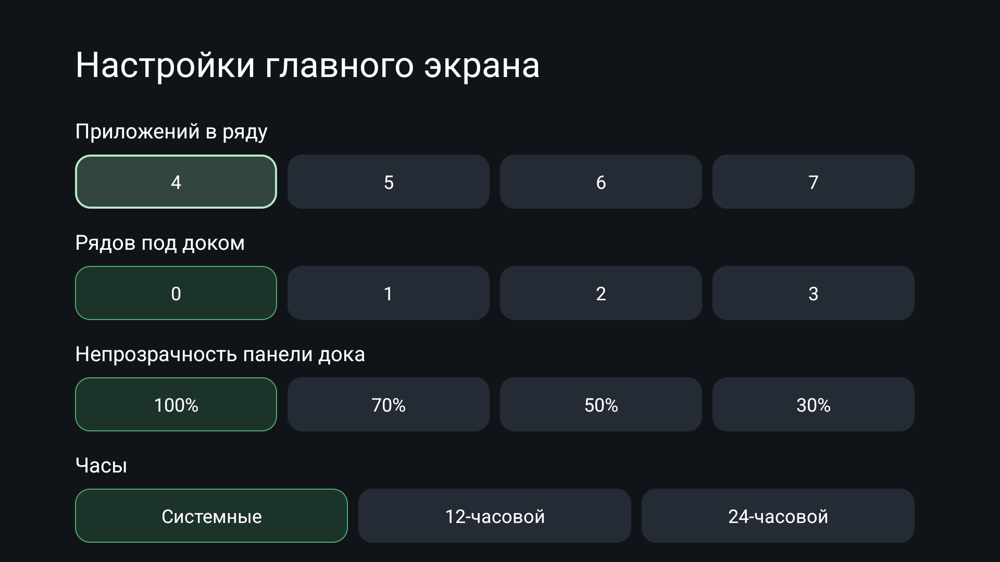

# NA TV Launcher

Русская сборка **NA TV Лаунчер** для Android TV. Название лаунчера на главном экране — **NA Clean Toour TV**. Интерфейс локализован на русский язык. Отключение системных приложений обратимо; ничего не удаляется.

## Скриншоты

С главного экрана запускаются установленные ТВ-приложения; настройки позволяют выбрать число плиток, вид дока и формат часов.





## Как открыть настройки лаунчера

На главном экране выделите кнопку **«Настройки»** в правом верхнем углу и удерживайте **OK** на пульте. В появившемся меню выберите **«Настройки главного экрана»**. Короткое нажатие на кнопку открывает системные настройки телевизора.

## Что отключено на приставке TX5

На проверенном устройстве с Android 14 обратимо отключены:

| Пакет | Назначение |
|---|---|
| `com.google.android.apps.tv.launcherx` | Штатный главный экран, чтобы Home открывал NA Clean Toour TV. |
| `com.oranth.deviceinforeport` | Отчёт об информации устройства. |
| `com.google.android.tvrecommendations` | Рекомендации и рекламные ряды штатного главного экрана. |

Приложения и системные пакеты не удалялись. Эти названия проверены только на этом TX5; не переносите список на другую модель без отдельной проверки. Замена главного экрана не блокирует рекламу внутри YouTube или других приложений.

## Перед началом

- Компьютер и телевизор должны быть в одной сети.
- Включите на ТВ параметры разработчика и отладку по сети/беспроводную отладку.
- Установите Android Platform Tools (`adb`), Python 3 и JDK 17.
- Не отключайте приложения, пока не проверили их назначение и не убедились, что они вам не нужны.

## Подключение по ADB

Для обычной сетевой отладки:

```powershell
adb connect <IP-телевизора>:<порт>
adb devices
```

Если устройство показывает `offline`, откройте на ТВ **Для разработчиков → Беспроводная отладка → Сопряжение с устройством по коду** и выполните команды с указанными на экране адресом и портом:

```powershell
adb pair <IP-телевизора>:<порт-сопряжения>
adb connect <IP-телевизора>:<порт-отладки>
adb devices
```

Подтвердите запрос отладки на телевизоре. Не публикуйте IP, код сопряжения, ключи ADB, серийный номер или снимки экрана с личными данными.

## Постоянный ADB на порту 5555 (без подтверждения)

На этой приставке (TX5, Android 14, userdebug) включён постоянный сетевой ADB, который поднимается сам после каждой загрузки:

| Свойство | Значение | Назначение |
|---|---|---|
| `persist.vendor.adb.enable` | `1` | Штатный механизм прошивки «Internet adb» (`/vendor/etc/init/hw/init.oranth.rc`): по `sys.boot_completed=1` выполняет `setprop service.adb.tcp.port 5555` и `restart adbd`. |
| `persist.adb.tcp.port` | `5555` | Резервный путь: adbd читает это свойство при каждом старте, даже если `service.adb.tcp.port` сброшен. |
| `ro.adb.secure` | не задано | На userdebug-прошивке (`ro.debuggable=1`) adbd считает `auth_required=false`, поэтому ключи и экран подтверждения не требуются. |

Подключение с любого компьютера в той же сети:

```powershell
adb connect 192.168.1.229:5555
adb devices
```

Проверка, что режим пережил перезагрузку:

```powershell
adb -s 192.168.1.229:5555 reboot
# дождитесь загрузки ТВ (~1,5–2 мин)
adb connect 192.168.1.229:5555
adb -s 192.168.1.229:5555 shell "getprop persist.adb.tcp.port; getprop service.adb.tcp.port"
```

Если сетевой ADB больше не нужен (доступ по сети при этом пропадёт — вернуть можно только по USB-кабелю):

```powershell
adb -s 192.168.1.229:5555 shell "setprop persist.vendor.adb.enable 0"
# обратно: setprop persist.vendor.adb.enable 1
```

⚠️ **Безопасность.** Пока режим включён, любой хост в локальной сети получает ADB-доступ без пароля и подтверждения, а `adb shell` на этой прошивке работает от `root`. Держите ТВ только в доверенной сети и отключайте режим после работ, если постоянный доступ не нужен.

## Резервная копия и очистка

Перед изменениями сохраните список пакетов, отключённых пакетов, свойства системы и настройки. Сначала определите модель ТВ и назначение каждого пакета. Не трогайте системные компоненты Android, ТВ/HDMI-входы, меню источников, Bluetooth и пульт, экранную клавиатуру, Google Play и Google Play Services.

В этом проекте приложения только **отключаются для пользователя**, а не удаляются. Скрипт проверяет защищённые пакеты и наличие способа вернуться к исходному экрану:

```powershell
py -3 -m venv tools\venv
tools\venv\Scripts\pip install -r tools\requirements.txt
$env:TV_HOST = '<IP-телевизора>'
tools\venv\Scripts\python.exe tools\tv.py --probe
```

Используйте только проверенный список для точной модели ТВ. Скрипт отключения и восстановление запускайте по инструкции в начале `tools\disable.ps1` и `tools\restore.ps1`. Не запускайте фабричные меню и не используйте `pm uninstall`.

Перед отключением потоковых приложений, голосового помощника, Chromecast/Miracast или обновлений выясните, какие из них нужны. Если назначение пакета неизвестно, оставьте его включённым.

## Сборка и установка лаунчера

Лаунчер требует Android 8.0 (API 26) или новее. Настройки приложений в нижнем ряду находятся в `launcher/app/src/main/res/values/config.xml`.

```powershell
$env:TV_HOST = '<IP-телевизора>'
./launcher/gradlew.bat -p launcher assembleRelease
```

Для установки используйте `launcher/build-and-install.ps1` после проверки модели, версии Android, доступности установки APK и текущего владельца кнопки Home. Не отключайте штатный лаунчер, пока новый не установлен и не подтверждён как домашний экран. На Android 13 и новее при необходимости задайте языковые настройки лаунчера на ТВ: `cmd locale set-app-locales com.gathin.tvhome --locales ru-RU`.

После работ закройте сетевой ADB, если он не нужен постоянно: в этой сборке по запросу владельца оставлен постоянный доступ на порту 5555 (команда отключения — в разделе «Постоянный ADB на порту 5555»).

## Возврат изменений

```powershell
$env:TV_HOST = '<IP-телевизора>'
tools\restore.ps1 -TvHost $env:TV_HOST <тот-же-файл-с-пакетами>
```

Список применённых изменений и резервную копию храните локально. Исходный проект и его правила безопасности описаны в [`PROMPT.md`](PROMPT.md) и [`AGENTS.md`](AGENTS.md). Эта русская сборка сохраняет исходную лицензию MIT ([`LICENSE`](LICENSE)).
